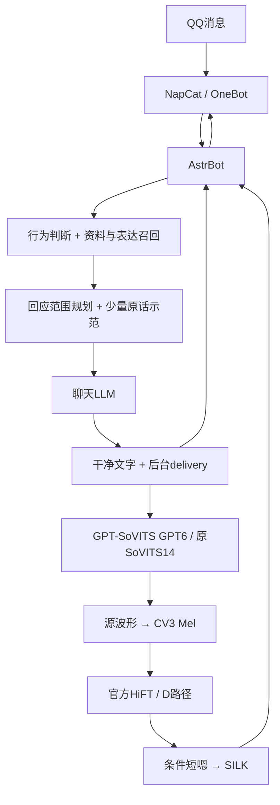

# 奶绿语音 Bot · Nailv Voice Bot

[](LICENSE)
[](docs/setup.md)
[](CHANGELOG.md)

从人物材料构建**有出处的记忆、按语境变化的说话方式和自然语音**，通过 AstrBot + NapCat 接入 QQ。

本仓库整理自“明前奶绿”角色 Bot 的实际制作过程，公开核心源码、训练/推理方法和可复刻文档。它是独立粉丝技术项目，不是主播本人或官方服务。聊天 LLM 未做人格微调；角色语言来自资料检索、真实表达示范和当前对话规划。

**v0.1.1 是源码预览版。**离线演示与检查可以直接运行；完整机器人需要使用者自行准备人物材料、模型、API配置和QQ账号。本仓库不附真人录音、个人训练权重、完整人物资料库或任何登录数据。公开副本尚未重新完成GPU推理和QQ真人收发验收，原项目的听感反馈不等于新部署的保证。

## 能做什么

- **有来源的知识检索**：固定身份、经历、偏好、互动示范与用户会话分开；关键词回退，支持智谱 embedding-3 语义检索。
- **人物表达还原**：先判断互动行为，召回24条表达候选，再选择0–3条，控制起句、转折、回应范围和停止位置；近期措辞冷却。
- **后台情绪路由**：六类实用语气，显示文字保持干净；特殊话题可覆盖笼统闲聊分类。
- **GPT节奏 + CV3声码路径**：保留 GPT-SoVITS V2 ProPlus 源声的语流，经 CV3 Mel 前端和官方 HiFT 输出。默认不加载CV3 LLM，不做Flow整句VC。
- **受限节奏保护**：参考特征深拷贝、异常语义重复重采样、保守静音判断、条件确认短“嗯”；保留原生语流。
- **离线音频评测**：CPU检查内容、声纹、韵律和高频异常。分数是技术代理，人物相似度与自然度由人判断；正式QQ不逐条跑完整评测。
- **QQ插件接入**：AstrBot原生会话/工具体系、NapCat OneBot、白名单与仅@触发、文字后接SILK语音。

## 三分钟离线体验

需要 Python 3.12+，以下命令无需API、模型或GPU：

```bash
python scripts/offline_demo.py
python -m unittest discover -s tests -v
python scripts/check_release.py
python scripts/doctor.py
```

演示使用明确标记的虚构数据，执行与原项目相同的情境分类和表达召回。它不会调用聊天模型或冒充已生成真人语音。`doctor`会如实列出未配置资产。

完整部署请继续读 [安装与资产接入](docs/setup.md) 和 [QQ接入](docs/qq.md)。

## 架构



GPT6、SoVITS14是原项目的人工选择，不是所有人物的最佳轮次。CV3的S3 Tokenizer、CAMPPlus和Flow仍用于当前初始化/参考预热，不能因为默认D不调用Flow生成就删除它们。D的HiFT直接接源Mel，情绪主要在GPT源声阶段形成。

## 文档导航

| 想了解什么 | 入口 |
|---|---|
| 为什么语言和说话方式像本人，具体怎样复刻 | [人物表达还原详解](docs/character-style.md) |
| 全部制作流程与技术取舍 | [制作复盘](docs/making-of.md) |
| 下一位AI或开发者从头怎么做 | [复刻流程](docs/reproduce.md)、[机器可读workflow](docs/workflow.json) |
| 独立环境、模型、配置与运行条件 | [安装说明](docs/setup.md) |
| 训练数据、权重选择和CPU评测 | [语音训练与验收](docs/voice.md) |
| AstrBot、NapCat、上下文重置与启停 | [QQ接入](docs/qq.md) |
| 参数、接口和已知问题 | [架构与限制](docs/architecture.md) |
| 哪些文件可公开、怎样发下一个版本 | [发布维护](docs/github-release.md) |

## 仓库结构

```text
implementation/     公开适配后的项目源码，保留原模块结构
  tools/            人设、RAG、表达与情绪路由
  runtime/          AstrBot插件、CV3/HiFT桥接、CPU评测
  voice/training/   GPT-SoVITS准备、训练和推理脚本
release_config.py   路径、账号和秘密文件的配置入口
config/             配置模板、原项目参数基线
examples/           虚构示例，不含原声素材
models/             官方模型来源与revision清单
scripts/            离线演示、资产检查、隔离工作区、发布检查
tests/              不依赖GPU和云端的测试
docs/               技术复盘、表达方法、复刻与运维
vendor-patches/     小型兼容补丁，附上游许可证
LICENSES/           上游许可证文本
```

`implementation/`同时保留部分研究/数据制作工具。正式主线见文档指定入口；历史工具的参数和费用记录不等于当前默认，也不应在现有资料上批量执行。源码导出记录见 `source-manifest.json`。

## 环境与边界

原项目在 Windows、RTX3060 Laptop 6GB显存、16GB内存上完成。保留不同引擎的独立环境；不把所有requirements混装进一个环境。6GB是原设备实测条件，不是任何输入下显存峰值的承诺。

源码不包含密钥、QQ号、登录二维码/Token、私人会话、录音、向量二进制和模型权重。真实数据和模型分别遵守其授权；本仓库的软件许可证不授予主播身份、声音或素材的使用权。见 [第三方说明](THIRD_PARTY_NOTICES.md)。

## 参与贡献

欢迎提交可复现问题与小范围修复。先读 [CONTRIBUTING](CONTRIBUTING.md)；敏感问题按 [SECURITY](SECURITY.md) 处理。不要在Issue里上传密钥、账号会话或未经许可的录音。

项目自有源码按 [AGPL-3.0](LICENSE) 发布；保留的第三方代码按各自许可证，模型和人物素材另计。依赖项目：[AstrBot](https://github.com/AstrBotDevs/AstrBot)、[NapCatQQ](https://github.com/NapNeko/NapCatQQ)、[GPT-SoVITS](https://github.com/RVC-Boss/GPT-SoVITS)、[CosyVoice](https://github.com/FunAudioLLM/CosyVoice)。

English readers: this is a source-preview release of a grounded character QQ bot. It combines source-backed style retrieval, hidden delivery routing, GPT-SoVITS source prosody and CV3 Mel/HiFT resynthesis. The offline demo needs no models or credentials. Full operation requires your own permitted data, weights, API configuration and fresh QQ instance; no celebrity dataset or voice weights are distributed.
